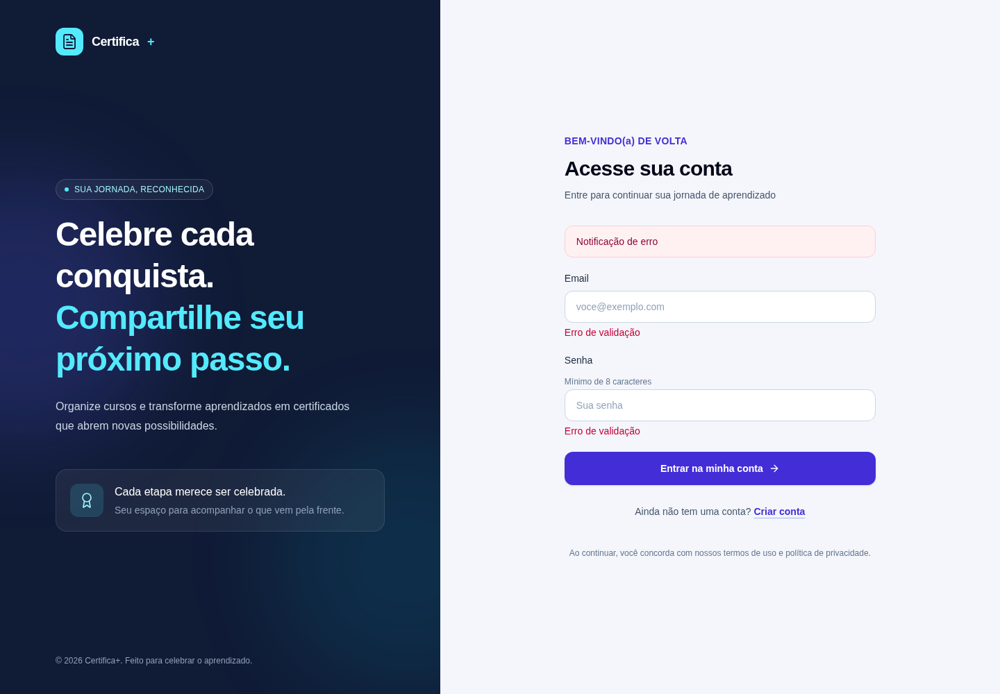

# Reorganização da API e Criação das Telas de Autenticação

## Evoluindo o Gerador de Certificados

O Gerador de Certificados é uma aplicação fullstack.

Ela possui uma API em ASP.NET Core e uma interface web em Angular.

À medida que um projeto cresce, manter todo o código junto dificulta entender onde cada responsabilidade deve ficar.

Nesta aula, vamos conhecer a organização usada na branch `v2` do [Gerador de Certificados](https://github.com/academiadoprogramador-fullstack/gerador-de-certificados-2026/tree/v2) e preparar as telas de cadastro e login do client.

Vamos observar:

- como a API foi organizada em projetos e módulos;
- como o workflow do GitHub Actions compila, aplica migrations e publica a API;
- como criar o client Angular com Tailwind CSS e Lucide;
- como compartilhar o layout entre as telas de autenticação;
- como organizar as rotas e os componentes de cadastro e login.

> Nesta versão, o foco do client é a apresentação das telas. Os formulários ainda não enviam dados para os endpoints de autenticação.

## Separando o client e o server

Na raiz do repositório, o código está dividido em duas pastas principais:

```text
gerador-de-certificados-2026/
├── client/
├── server/
└── .github/
    └── workflows/
```

O `client` contém a aplicação Angular.

O `server` contém a API .NET.

Essa separação permite executar, compilar e configurar cada parte de forma independente.

Dentro de `server`, a solução e seus projetos ficam organizados assim:

```text
server/
├── GeradorCertificadosOnline.slnx
├── dotnet-tools.json
└── src/
    ├── Api/
    ├── Aplicacao/
    ├── Dominio/
    └── Infraestrutura/
```

Cada projeto possui uma responsabilidade:

- `Api`: recebe requisições HTTP e transforma os resultados em respostas;
- `Aplicacao`: coordena casos de uso e operações da aplicação;
- `Dominio`: contém conceitos e regras centrais do negócio;
- `Infraestrutura`: implementa acesso a dados e integrações externas.

O arquivo `GeradorCertificadosOnline.slnx` reúne os projetos .NET da solução.

## Organizando a API por módulos

Além da separação por projetos, os endpoints da API são agrupados por funcionalidade.

Por exemplo, a API contém módulos para autenticação, cursos e certificados:

```text
server/src/Api/Modulos/
├── Auth/
├── Cursos/
└── Certificados/
```

No módulo `Auth`, encontramos o `AuthController` e os contratos HTTP:

```text
server/src/Api/Modulos/Auth/
├── AuthContracts.cs
└── AuthController.cs
```

Um **contrato HTTP** descreve os dados que a API recebe ou devolve.

Na referência, os dados de entrada são representados por records:

```csharp
public sealed record LoginRequest(string Email, string Senha);

public sealed record CadastroRequest(string Email, string Senha);
```

O Controller recebe esses contratos e encaminha a operação para a camada de aplicação usando o MediatR.

Assim, o Controller não precisa executar diretamente toda a regra de autenticação.

```text
requisição HTTP
  -> AuthController
    -> comando da Aplicação
      -> regra de autenticação
        -> resposta HTTP
```

Por exemplo, o cadastro usa `POST /auth/cadastro` e o login usa `POST /auth/login`.

Ambos podem ser acessados sem um token, pois são as operações que permitem criar uma conta ou iniciar uma sessão.

## Entendendo o workflow de publicação

O workflow de publicação fica em:

```text
.github/workflows/deploy-server-azure.yml
```

Ele é executado quando ocorre um `push` na branch `main` com alterações em `server/**`.

Também pode ser iniciado manualmente pelo GitHub Actions.

O fluxo possui três jobs:

```text
build
  ├── migrate
  └── deploy (aguarda build e migrate)
```

O job `build` prepara o .NET, compila e publica a API em um artefato.

Um **artefato** é um conjunto de arquivos produzido por um job e disponibilizado para outros jobs.

O job `migrate` aplica as migrations no banco de produção.

O job `deploy` baixa o artefato, autentica na Azure e publica os arquivos no App Service.

Os jobs dependentes usam `needs` para controlar a ordem. A publicação só começa depois que o build e as migrations terminam com sucesso.

O workflow obtém connection strings, chaves e credenciais por meio dos **secrets** do GitHub.

> **Atenção:** não coloque senhas, connection strings ou chaves privadas diretamente no arquivo YAML ou no código-fonte.

### Conferindo os caminhos usados no workflow

Na branch `v2`, a solução foi movida para `server/GeradorCertificadosOnline.slnx`, e o projeto de inicialização da API está em `server/src/Api`.

Por isso, comandos executados a partir da raiz do repositório precisam indicar o caminho da solução ou do projeto.

Por exemplo, para compilar a solução:

```bash
dotnet build server/GeradorCertificadosOnline.slnx --configuration Release
```

E para publicar a API:

```bash
dotnet publish server/src/Api/GeradorCertificadosOnline.Api.csproj \
  --configuration Release \
  --output ./artifacts/api
```

O workflow da referência usa `dotnet build --configuration Release` e `dotnet publish` sem indicar esses caminhos.

Como não há uma solução .NET na raiz do repositório, esses passos precisam ser conferidos e ajustados para apontar à solução e ao projeto corretos antes de depender deles em uma publicação.

## Criando o client Angular

O client usa Angular CLI 22.2.0.

Em um repositório vazio, podemos criar a pasta `client` com a aplicação Angular dentro dela:

```bash
npx --yes @angular/cli@22.2.0 new client --style=css --defaults
```

Na referência, o projeto Angular também fica dentro da pasta `client`.

Para executar o client já existente no repositório:

```bash
cd client
npm ci
npm start
```

O comando `npm ci` instala as versões registradas no `package-lock.json`.

O comando `npm start` inicia o servidor local do Angular.

## Configurando Tailwind CSS

O Tailwind CSS é um framework de estilos baseado em classes utilitárias.

Em vez de criar uma classe CSS para cada detalhe visual, combinamos classes no template, como `rounded-xl`, `px-4`, `text-slate-700` e `focus:ring-4`.

A referência utiliza Tailwind CSS 4.

Para configurar essa versão em um projeto Angular, instale os pacotes necessários:

```bash
npm install tailwindcss@4.1.12 @tailwindcss/postcss@4.1.12 postcss --force
```

O `--force` é utilizado no setup de referência para permitir a instalação apesar de uma divergência de peer dependency entre a integração do Angular e o Tailwind CSS 4.

Use essa opção apenas junto das versões verificadas para o projeto.

Na raiz de `client`, o arquivo `.postcssrc.json` registra o plugin do Tailwind:

```json
{
  "plugins": {
    "@tailwindcss/postcss": {}
  }
}
```

No arquivo `src/styles.css`, carregue o Tailwind:

```css
@import 'tailwindcss';
```

O Angular CLI processa esse arquivo durante a compilação.

Na referência, `src/styles.css` já está configurado como estilo global em `angular.json`.

## Instalando e usando Lucide Angular

O Lucide fornece ícones vetoriais em SVG.

Para usar seus ícones em Angular, o projeto instala o pacote `@lucide/angular`:

```bash
npm install @lucide/angular@1.56.0
```

Um ícone é importado como um componente standalone e adicionado à propriedade `imports` do componente que o utiliza.

Por exemplo, a tela de cadastro usa `LucideArrowRight`:

```typescript
import { Component } from '@angular/core';
import { LucideArrowRight } from '@lucide/angular';

@Component({
  imports: [LucideArrowRight],
  selector: 'app-exemplo',
  template: '<svg lucideArrowRight aria-hidden="true"></svg>',
})
export class Exemplo {}
```

O SVG é inserido no template pelo seletor `lucideArrowRight`.

O atributo `aria-hidden="true"` informa que o ícone é decorativo e não precisa ser anunciado por um leitor de tela.

## Organizando as rotas de autenticação

O client separa as telas em rotas:

```text
client/src/app/
├── app.config.ts
├── app.html
└── auth/
    ├── pagina-autenticacao.ts
    ├── pagina-autenticacao.html
    ├── cadastro/
    │   ├── cadastro.ts
    │   └── cadastro.html
    └── login/
        ├── login.ts
        └── login.html
```

O `app.config.ts` registra o Router e associa os caminhos às telas:

```typescript
const routes: Routes = [
  {
    path: '',
    loadComponent: () => import('./home/home').then((componente) => componente.Home),
  },
  {
    path: 'cadastro',
    loadComponent: () => import('./auth/cadastro/cadastro').then((componente) => componente.Cadastro),
  },
  {
    path: 'login',
    loadComponent: () => import('./auth/login/login').then((componente) => componente.Login),
  },
];
```

O `loadComponent` carrega cada componente quando a rota é acessada.

No componente raiz, o `<router-outlet>` indica onde a tela da rota atual será exibida:

```html
<router-outlet></router-outlet>
```

Assim, `/cadastro` abre o componente `Cadastro` e `/login` abre o componente `Login`.

## Compartilhando o layout das telas

Cadastro e login usam a mesma composição visual: uma área de apresentação da marca e uma área para o formulário.

Em vez de repetir todo o layout nos dois templates, a referência cria o componente `PaginaAutenticacao`.

Ele funciona como um **wrapper**, ou componente que envolve outros elementos.

O elemento `<ng-content>` define o local em que o conteúdo da tela será projetado:

```html
<main class="min-h-screen bg-[#f4f6fb] text-slate-900 lg:grid lg:grid-cols-2">
  <section class="hidden bg-slate-900 p-12 text-white lg:flex">
    <!-- Marca e mensagem de apresentação -->
  </section>

  <section class="flex min-h-screen items-center justify-center px-5 py-10">
    <div class="w-full max-w-md">
      <ng-content />
    </div>
  </section>
</main>
```

O componente de cadastro pode então fornecer apenas o conteúdo específico daquela tela:

```html
<app-pagina-autenticacao>
  <h2 class="text-3xl font-semibold text-slate-950">Crie sua conta</h2>
  <p class="mt-2 text-sm text-slate-600">
    Um passo simples para organizar e celebrar suas conquistas.
  </p>

  <!-- Formulário de cadastro -->
</app-pagina-autenticacao>
```

O componente de login usa o mesmo wrapper, mas fornece seu próprio título, texto e formulário.

## Criando os componentes de cadastro e login

Na pasta `client`, gere os componentes:

```bash
npx ng generate component auth/pagina-autenticacao
npx ng generate component auth/cadastro
npx ng generate component auth/login
```

O wrapper importa `RouterLink` para que a marca possa retornar à página inicial e Lucide Icons para exibir ícones de certificado.

Cada tela importa o wrapper, `RouterLink` e o ícone de seta usado no botão:

```typescript
import { Component } from '@angular/core';
import { RouterLink } from '@angular/router';
import { LucideArrowRight } from '@lucide/angular';
import { PaginaAutenticacao } from '../pagina-autenticacao';

@Component({
  imports: [LucideArrowRight, PaginaAutenticacao, RouterLink],
  selector: 'app-cadastro',
  templateUrl: './cadastro.html',
})
export class Cadastro {}
```

O componente `Login` segue a mesma estrutura, com o seletor `app-login` e o template `login.html`.

## Compondo o formulário de cadastro

O formulário de cadastro pede e-mail e senha.

As classes Tailwind organizam espaçamento, bordas, cores e estados de foco:

```html
<form novalidate class="space-y-5">
  <div>
    <label for="cadastro-email" class="mb-2 block text-sm font-medium text-slate-800">
      Email
    </label>
    <input
      id="cadastro-email"
      type="email"
      autocomplete="email"
      class="w-full rounded-xl border border-slate-300 px-4 py-3 focus:border-indigo-600 focus:ring-4"
      placeholder="voce@exemplo.com"
    />
  </div>

  <div>
    <label for="cadastro-senha" class="mb-2 block text-sm font-medium text-slate-800">
      Senha
    </label>
    <input
      id="cadastro-senha"
      type="password"
      autocomplete="new-password"
      class="w-full rounded-xl border border-slate-300 px-4 py-3 focus:border-indigo-600 focus:ring-4"
      placeholder="Crie uma senha segura"
    />
    <p class="mt-2 text-xs text-slate-600">
      Use ao menos 8 caracteres, incluindo um número e um símbolo.
    </p>
  </div>

  <button class="inline-flex w-full items-center justify-center gap-2 rounded-xl bg-indigo-700 px-5 py-3 text-white">
    Criar minha conta <svg lucideArrowRight class="size-4" aria-hidden="true"></svg>
  </button>
</form>
```

O atributo `for` do `<label>` corresponde ao `id` do campo.

Essa associação ajuda pessoas que usam leitores de tela e também permite focar o campo ao selecionar seu rótulo.

## Compondo o formulário de login

O login tem uma estrutura parecida, mas usa textos e identificadores próprios:

```html
<form novalidate class="space-y-5">
  <div>
    <label for="login-email" class="mb-2 block text-sm font-medium text-slate-800">
      Email
    </label>
    <input
      id="login-email"
      type="email"
      autocomplete="email"
      class="w-full rounded-xl border border-slate-300 px-4 py-3"
      placeholder="voce@exemplo.com"
    />
  </div>

  <div>
    <label for="login-senha" class="mb-2 block text-sm font-medium text-slate-800">
      Senha
    </label>
    <input
      id="login-senha"
      type="password"
      autocomplete="current-password"
      class="w-full rounded-xl border border-slate-300 px-4 py-3"
      placeholder="Sua senha"
    />
  </div>

  <button class="inline-flex w-full items-center justify-center gap-2 rounded-xl bg-indigo-700 px-5 py-3 text-white">
    Entrar na minha conta <svg lucideArrowRight class="size-4" aria-hidden="true"></svg>
  </button>
</form>
```

No fim de cada tela, um link com `routerLink` leva à outra rota:

```html
<a routerLink="/login">Entrar</a>
```

O cadastro usa o caminho `/login` para levar o usuário existente à tela de login.

Na tela de login, o link usa `routerLink="/cadastro"`.

## Visualizando as rotas completas

As capturas abaixo mostram as rotas `/cadastro` e `/login` da aplicação da branch `v2`, em uma janela desktop.

Elas foram feitas com Playwright usando a aplicação executada localmente.




As mensagens de erro visíveis nas capturas são textos estáticos presentes nos templates da branch `v2`.

Elas ainda não representam erros de validação ou respostas reais da API.

## Limite desta etapa: as telas ainda não autenticam

Os endpoints da API já estão disponíveis:

- `POST /auth/cadastro` cria uma conta;
- `POST /auth/login` valida as credenciais e devolve um token JWT.

No entanto, os componentes de referência ainda não possuem ligação com esses endpoints.

Os campos não estão ligados a um formulário Angular, e o elemento `<form>` não possui um evento `(ngSubmit)`.

As mensagens de erro presentes nos templates são conteúdo visual de demonstração, não erros retornados pela API.

Portanto, nesta etapa estamos construindo a interface e a navegação entre as telas.

O envio dos dados, a validação, o tratamento de `ProblemDetails` e o armazenamento seguro do token serão assuntos de integração posteriores.

## Conclusão

A branch `v2` separa o client e o server, organiza a API em projetos e módulos e define um workflow de publicação para a API.

No Angular, Tailwind CSS ajuda a compor os estilos por meio de classes utilitárias, e Lucide fornece ícones como componentes standalone.

Um wrapper reutiliza a estrutura visual entre cadastro e login, enquanto as rotas exibem cada tela no momento adequado.

As telas formam a base para uma integração futura com os endpoints de autenticação.
