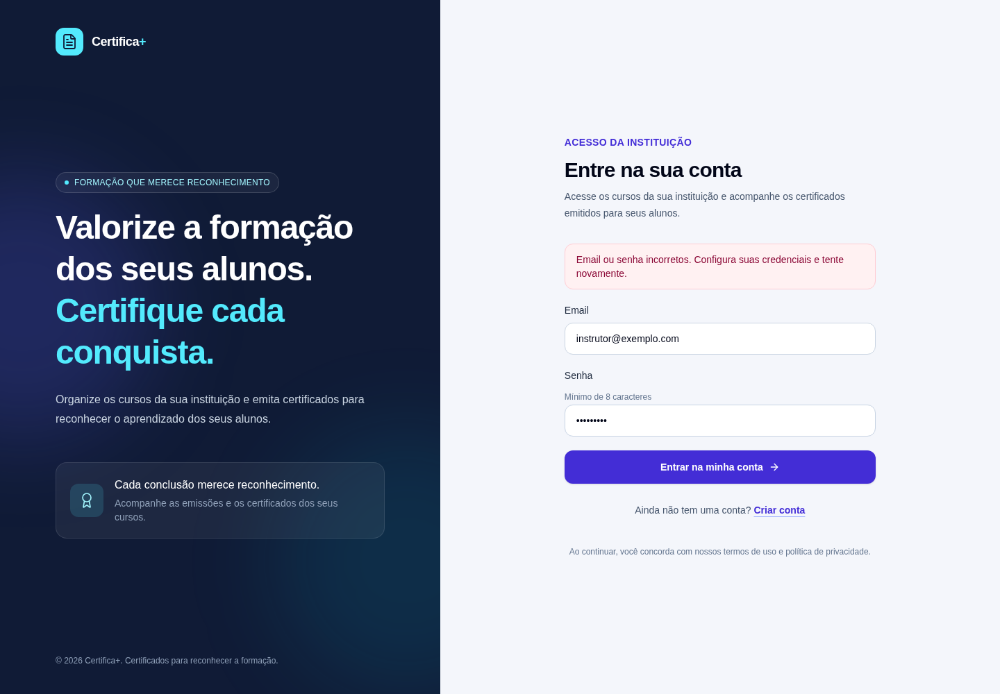

# Signals, Sessões e Módulo de Cursos

## Evoluindo o Gerador de Certificados

Na aula anterior, conectamos os formulários de cadastro e login à API e vimos como a sessão fica em memória.

No Gerador de Certificados, o projeto avança em três frentes:

- exibe erros da API nas telas de autenticação;
- persiste a sessão no navegador;
- associa cursos e certificados ao usuário autenticado.

## Apresentando erros da API com Signals

Uma requisição pode falhar mesmo quando o formulário está válido.

Por exemplo, o e-mail pode já estar cadastrado, a senha pode estar incorreta ou a API pode estar indisponível.

Os componentes `Cadastro` e `Login` usam Signals para representar o estado visual da requisição:

```typescript
protected readonly mensagemErro = signal('');
protected readonly enviandoFormulario = signal(false);
```

Na tela de login há também um Signal para a confirmação do cadastro:

```typescript
protected readonly mensagemSucesso = signal('');
```

Esses Signals representam estados independentes:

- `mensagemErro`: texto de erro a apresentar;
- `mensagemSucesso`: confirmação apresentada após navegar do cadastro;
- `enviandoFormulario`: indica que a requisição ainda está em andamento.

Antes de enviar a requisição, o componente limpa a mensagem anterior e ativa o estado de envio:

```typescript
this.mensagemErro.set('');
this.enviandoFormulario.set(true);
```

O `subscribe` recebe um Observer com uma função para cada resultado importante. No login, o tratamento do erro segue esta ideia:

```typescript
const observer: Partial<Observer<TokenDto>> = {
  next: () => {
    this.enviandoFormulario.set(false);
    void this.router.navigateByUrl('/');
  },
  error: (response: HttpErrorResponse) => {
    this.enviandoFormulario.set(false);

    const mensagem =
      response.status === 401
        ? 'Email ou senha incorretos. Confira suas credenciais e tente novamente.'
        : this.obterMensagemErroApi(response);

    this.mensagemErro.set(mensagem);
  },
};

this.authService.login(requisicao).subscribe(observer);
```

O status `401` significa que as credenciais não foram aceitas.

Para outros erros, `obterMensagemErroApi` tenta usar o `detail` enviado pela API. Se não houver detalhe, apresenta uma mensagem genérica de indisponibilidade.

O template lê o Signal e só cria o aviso quando há uma mensagem:

```html
@if (mensagemErro()) {
  <div role="alert">
    {{ mensagemErro() }}
  </div>
}
```

O atributo `role="alert"` informa às tecnologias assistivas que o conteúdo é uma mensagem importante que deve ser anunciada.

No cadastro, a resposta `409` recebe uma orientação específica, pois significa que o e-mail já está em uso.

Erros de validação podem vir em `errors`, um mapa de campos para listas de mensagens. O componente percorre essas listas e reúne os textos para apresentá-los.

Assim, a mensagem deixa de ser um texto fixo do template e passa a refletir a resposta recebida.

## Evitando envios repetidos

Enquanto a requisição está em andamento, `enviandoFormulario` permanece `true`.

O template usa esse estado para desabilitar o botão:

```html
<button
  type="submit"
  [disabled]="enviandoFormulario()"
  [attr.aria-busy]="enviandoFormulario()"
>
  Entrar na minha conta
</button>
```

Em cada caminho de conclusão — sucesso ou erro — o componente volta a definir o Signal como `false`.

Isso evita envios repetidos por cliques enquanto a API ainda processa a primeira requisição.

## Observando a notificação de erro

A captura abaixo mostra a tela de login após uma resposta `401` simulada no endpoint de login.

O formulário e a mensagem são renderizados pelo client; a simulação permite observar o estado visual sem depender de credenciais ou de uma API em execução.



## Persistindo a sessão no AuthService

Um Signal em memória é reiniciado quando a aplicação recarrega.

O `AuthService` combina o Signal com `localStorage` para recuperar a sessão no início do serviço e gravá-la após o login.

O nome da chave é recebido por um `InjectionToken`:

```typescript
export const CHAVE_ARMAZENAMENTO =
  new InjectionToken<string>('CHAVE_ARMAZENAMENTO');
```

O valor é configurado junto aos outros provedores da aplicação. Isso evita espalhar o nome da chave pelo serviço.

Ao iniciar, o Signal recebe o resultado da leitura:

```typescript
private readonly sessaoState = signal<SessaoAutenticada | null>(this.lerSessao());
readonly sessao = this.sessaoState.asReadonly();
```

No login, o serviço monta o objeto de sessão e salva tanto no armazenamento quanto no Signal:

```typescript
private salvarSessao(token: TokenDto, email: string): void {
  const sessao: SessaoAutenticada = {
    token,
    usuario: { id: token.usuarioId, email },
  };

  localStorage.setItem(this.chaveArmazenamento, JSON.stringify(sessao));
  this.sessaoState.set(sessao);
}
```

O Signal mantém a interface reativa enquanto a aplicação está aberta.

O `localStorage` recupera os dados quando o serviço é criado novamente.

Ao encerrar a sessão, o serviço remove a chave, limpa o Signal e navega para `/login`.

## Validando os dados recuperados

Os dados de `localStorage` são texto e podem estar ausentes, incompletos, inválidos ou antigos.

Por isso, `lerSessao()` trata a leitura com `try/catch` e valida os elementos necessários:

- a sessão precisa conter token e usuário;
- o token precisa ter `accessToken`;
- o usuário precisa ter e-mail;
- a data de expiração precisa ser válida e futura.

Se alguma condição falhar, o serviço remove os dados e inicia sem sessão.

Isso é importante porque manter um token no armazenamento não estende a validade que a API definiu.

> **Atenção:** scripts executados na página podem ler o `localStorage`. Uma vulnerabilidade de XSS pode expor o token. Proteja a aplicação contra XSS e avalie a estratégia de armazenamento adequada ao contexto; cookies `HttpOnly`, `Secure` e `SameSite` exigem configuração coordenada com o backend.

## O módulo de cursos na API

O módulo de cursos possui endpoints de cadastro, listagem e consulta por identificador:

| Método | Rota | Resultado |
| --- | --- | --- |
| `POST` | `/cursos` | Cria um curso e responde `201 Created`. |
| `GET` | `/cursos` | Lista os cursos do usuário autenticado. |
| `GET` | `/cursos/{cursoId}` | Consulta um curso pertencente ao usuário autenticado. |

Um curso contém nome, carga horária e data de conclusão.

O cadastro valida os dados no domínio antes de persistir e retorna um `CursoDto`.

A listagem ordena os resultados por nome e usa o identificador como critério secundário:

```csharp
return await db.Cursos
    .AsNoTracking()
    .Where(curso => curso.UsuarioId == usuarioId)
    .OrderBy(curso => curso.Nome)
    .ThenBy(curso => curso.Id)
    .ToListAsync(cancellationToken);
```

Se o usuário autenticado ainda não tiver cursos, a API retorna uma lista vazia (`[]`).

## Isolando os dados por usuário

Uma lista de cursos não pode retornar registros de outras instituições.

Por isso, as operações protegidas obtêm o identificador do usuário a partir da identidade autenticada no token:

```csharp
private Guid ObterUsuarioId()
{
    return Guid.Parse(User.FindFirstValue(ClaimTypes.NameIdentifier)!);
}
```

O Controller passa esse identificador para os casos de uso.

O repositório usa o par curso/usuário para buscar ou verificar a existência de um curso. Conhecer um `cursoId` de outra conta não deve dar acesso ao registro.

O mesmo princípio foi aplicado aos certificados: cadastro, listagem, processamento, consulta de status e download consideram o usuário autenticado. Os certificados também recebem `UsuarioId`.

Uma migration adiciona `UsuarioId` às tabelas `Cursos` e `Certificados`, cria índices e relacionamentos com `AspNetUsers`.

> Autenticação identifica quem fez a chamada. O filtro por `UsuarioId` é o que limita os dados retornados a essa identidade.

## O que ainda não existe no client?

Embora a API permita criar, listar e consultar cursos, ainda não há telas Angular para essas operações.

A página inicial apresenta a proposta do produto, mas não contém um formulário de curso nem uma listagem conectada à API.

O README também indica que a integração do client às operações de cursos será desenvolvida depois.

Portanto, nesta etapa, podemos testar o módulo pelo Swagger ou pelas requisições de exemplo em `server/src/Api/GeradorCertificadosOnline.Api.http`.

As rotas de cursos exigem um token Bearer. Sem token, a API responde `401 Unauthorized`.

## Testando as operações de curso

Com a API e as dependências configuradas, o arquivo de requisições HTTP mostra o fluxo completo:

1. Cadastre um usuário e faça login para obter um token.
2. Envie `GET /cursos` com o Bearer token; sem cursos, a resposta deve ser `[]`.
3. Envie `POST /cursos` com nome, carga horária e data de conclusão.
4. Consulte o identificador retornado em `GET /cursos/{cursoId}`.
5. Faça login com outro usuário e confirme que os cursos da primeira conta não aparecem.

O arquivo também exemplifica respostas `400`, `401`, `404`, `409` e `202` para validações e operações relacionadas à geração dos certificados.

## Conclusão

Signals permitem que os formulários representem mensagens de sucesso, erros da API e o estado de envio.

O `AuthService` mantém esse estado reativo e usa `localStorage` para recuperar a sessão, validando os dados e a expiração do token.

No backend, o módulo de cursos passa a listar e consultar dados no contexto do usuário autenticado. O mesmo isolamento é aplicado às operações de certificados.

O próximo passo do client será criar as telas que consumirão essas operações de cursos.
