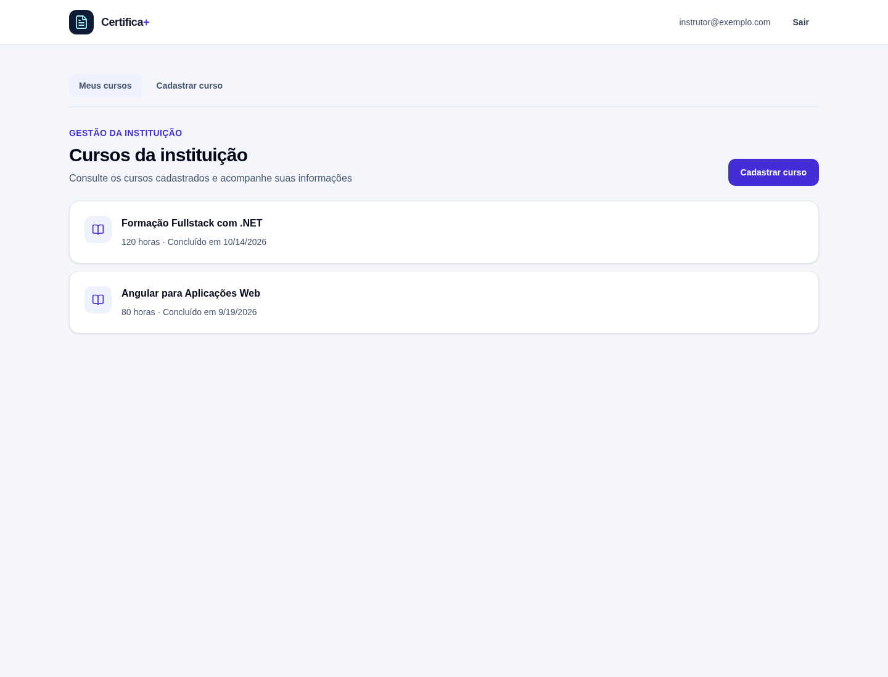
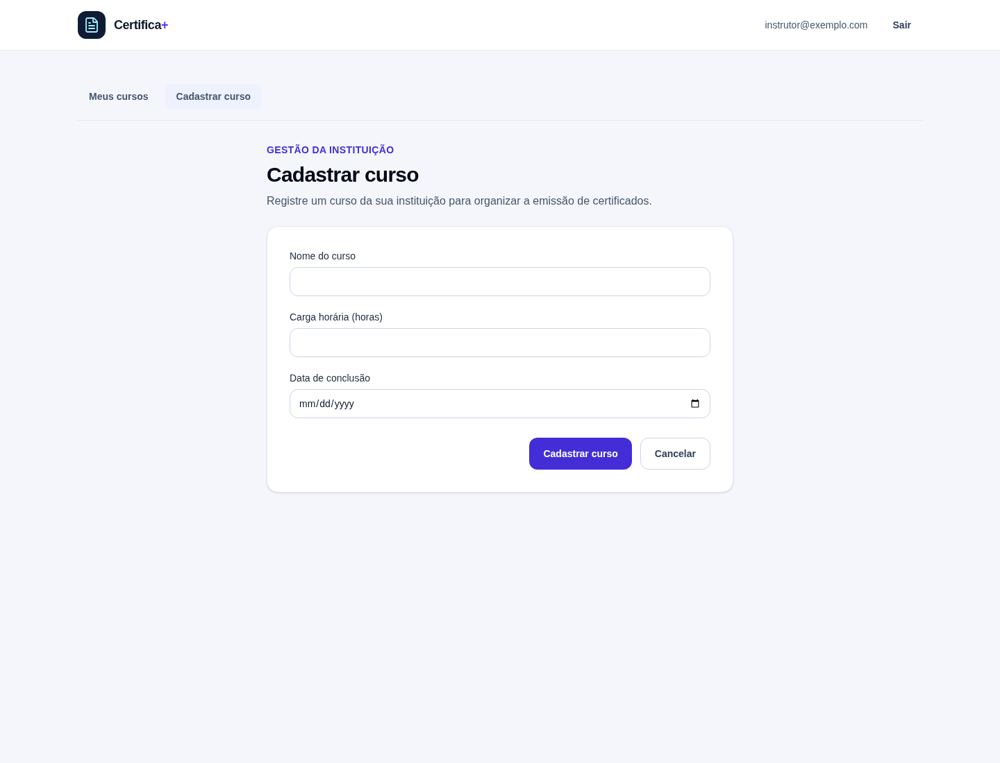
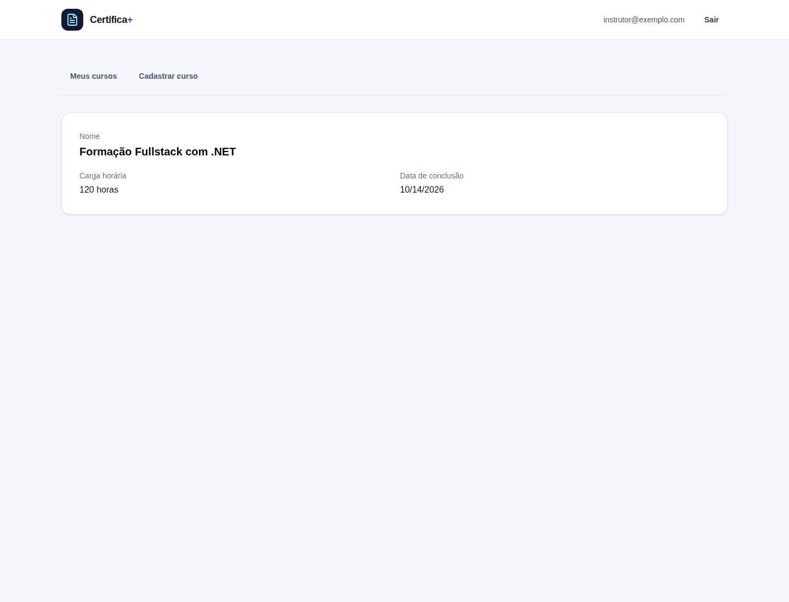

# Módulo de Cursos no Client e na API

## Cursos pertencem a uma instituição

O Gerador de Certificados permite que uma instituição organize seus cursos e emita certificados para os alunos.

Como várias instituições podem usar a aplicação, cada conta deve acessar somente os próprios dados.

Nesta aula, vamos acompanhar o fluxo completo: as telas Angular enviam requisições para a API, e o backend limita os dados à instituição autenticada.

## Navegando pelo módulo no Angular

As rotas de cursos ficam agrupadas sob `/cursos`:

| Rota | Componente | Responsabilidade |
| --- | --- | --- |
| `/cursos/listar` | `ListarCursos` | Exibe os cursos da instituição. |
| `/cursos/cadastrar` | `CadastrarCurso` | Apresenta o formulário de cadastro. |
| `/cursos/detalhes/:cursoId` | `DetalhesCurso` | Exibe os dados de um curso. |

Um componente de layout envolve essas telas com a barra de navegação e os links **Meus cursos** e **Cadastrar curso**.

As rotas são carregadas sob demanda. Assim, o Angular carrega o componente de cada página quando a pessoa navega até ela.

## Centralizando as chamadas em CursosService

O `CursosService` concentra a comunicação HTTP do módulo:

```typescript
listar(): Observable<readonly CursoDto[]> {
  return this.http.get<readonly CursoDto[]>(`${this.urlApi}/cursos`);
}

cadastrar(requisicao: CriarCursoRequest): Observable<CursoDto> {
  return this.http.post<CursoDto>(`${this.urlApi}/cursos`, requisicao);
}

obterPorId(cursoId: string): Observable<CursoDto> {
  return this.http.get<CursoDto>(`${this.urlApi}/cursos/${cursoId}`);
}
```

Os modelos TypeScript `CursoDto` e `CriarCursoRequest` descrevem os dados recebidos e enviados.

O interceptor de autenticação acrescenta o token Bearer do `AuthService` às requisições do `HttpClient`. Assim, os componentes não precisam montar esse cabeçalho individualmente.

Se a sessão não tiver token, o interceptor encaminha a requisição sem alterá-la:

```typescript
export const authInterceptor: HttpInterceptorFn = (request, next) => {
  const accessToken = inject(AuthService).sessao()?.token.accessToken;

  if (!accessToken) return next(request);

  return next(
    request.clone({ setHeaders: { Authorization: `Bearer ${accessToken}` } }),
  );
};
```

## Listando os cursos

A tela de listagem mantém três estados em Signals:

- `cursos`: os itens recebidos da API;
- `carregando`: indica que a consulta ainda está em andamento;
- `mensagemErro`: informa que a consulta falhou.

Ao iniciar, o componente ativa o estado de carregamento e chama `CursosService.listar()`.

Quando a API responde, a lista é atualizada. Se não houver cursos, a página exibe uma mensagem convidando a cadastrar o primeiro.

Durante a consulta, a interface mostra **Carregando cursos...**. Se ocorrer uma falha, exibe uma mensagem acessível com `role="alert"`.

Quando existem cursos, cada item mostra nome, carga horária e data de conclusão. Selecionar um item abre sua rota de detalhes.



## Cadastrando um curso

O formulário coleta três dados:

- nome do curso;
- carga horária em horas;
- data de conclusão.

O Signal Forms valida os campos antes do envio:

- o nome é obrigatório e pode ter no máximo 200 caracteres;
- a carga horária é obrigatória e deve ser maior que zero;
- a data de conclusão é obrigatória.

Se o formulário for inválido, os campos são marcados como visitados para exibir as mensagens de validação.

Se for válido, o componente remove espaços excedentes do nome, monta um `CriarCursoRequest` e envia a requisição pelo serviço.

Enquanto a API processa o cadastro, `enviandoFormulario` desabilita o botão e altera seu texto para **Cadastrando...**.

Em caso de sucesso, a aplicação navega de volta para `/cursos/listar`. Em caso de erro, mostra as mensagens por campo retornadas pela API ou uma mensagem geral.



## Consultando os detalhes

A rota de detalhes recebe `cursoId` como parâmetro.

O componente lê esse valor, chama `CursosService.obterPorId()` e mantém Signals para o curso, o carregamento e uma possível mensagem de erro.

Enquanto aguarda, mostra **Carregando curso...**. Quando recebe a resposta, apresenta nome, carga horária e data de conclusão.

Se o identificador estiver ausente ou a API não encontrar um curso acessível, a página exibe uma mensagem de erro.



As capturas foram feitas com Playwright. Para ilustrar as telas sem depender de credenciais ou de serviços externos, as respostas da API foram simuladas com dados de exemplo.

## Endpoints de cursos

O módulo disponibiliza três operações:

| Método | Rota | Resultado |
| --- | --- | --- |
| `POST` | `/cursos` | Cria um curso e responde `201 Created`. |
| `GET` | `/cursos` | Lista os cursos do usuário autenticado. |
| `GET` | `/cursos/{cursoId}` | Consulta um curso pertencente ao usuário autenticado. |

Um curso contém nome, carga horária e data de conclusão.

O cadastro valida os dados no domínio antes de persistir e retorna um `CursoDto`.

## Filtragem e ordenação na API

O endpoint `GET /cursos` envia uma consulta ao caso de uso, incluindo o identificador do usuário autenticado.

O repositório filtra os cursos por esse identificador e ordena os resultados por nome. Em caso de empate, usa o identificador do curso como critério secundário:

```csharp
return await db.Cursos
    .AsNoTracking()
    .Where(curso => curso.UsuarioId == usuarioId)
    .OrderBy(curso => curso.Nome)
    .ThenBy(curso => curso.Id)
    .ToListAsync(cancellationToken);
```

Se a conta ainda não tiver cursos, a API responde com uma lista vazia (`[]`).

## Obtendo a identidade autenticada

As rotas de cursos exigem autenticação Bearer.

O Controller obtém o identificador da pessoa autenticada a partir das claims do token:

```csharp
private Guid ObterUsuarioId()
{
    return Guid.Parse(User.FindFirstValue(ClaimTypes.NameIdentifier)!);
}
```

Esse identificador é enviado para o caso de uso tanto no cadastro quanto na listagem e na consulta por identificador.

Autenticar a pessoa confirma quem está fazendo a chamada.

O filtro por usuário garante que a resposta contenha somente dados associados a essa identidade.

## Protegendo a consulta por identificador

Não basta filtrar a listagem.

Uma pessoa poderia tentar consultar diretamente um `cursoId` pertencente a outra instituição.

Por isso, a consulta por identificador procura o curso usando os dois valores: o identificador do curso e o identificador do usuário.

Se não encontrar um registro que corresponda aos dois, o caso de uso retorna o erro de curso não encontrado.

O repositório também usa o mesmo critério ao verificar se um curso existe antes de iniciar outras operações.

## Persistindo o vínculo

O domínio associa cada curso ao usuário proprietário por meio de `UsuarioId`.

O Entity Framework Core configura esse vínculo no banco de dados. A migration correspondente adiciona a coluna `UsuarioId` às tabelas `Cursos` e `Certificados`, cria índices e relacionamentos com `AspNetUsers`.

Os certificados também ficam associados ao usuário.

Assim, o isolamento é mantido ao solicitar uma geração, listar certificados, consultar o processamento ou baixar o arquivo ZIP.

> O identificador do curso não é uma autorização. A API também precisa confirmar que o curso pertence ao usuário autenticado.

## Testando o fluxo

Com a API e o banco de dados configurados:

1. Cadastre um usuário e faça login no client.
2. Abra **Meus cursos** e observe o estado de carregamento ou a mensagem de lista vazia.
3. Cadastre um curso com nome, carga horária e data de conclusão válidos.
4. Confirme que o curso aparece na listagem e abra seus detalhes.
5. Faça login com outra conta e confirme que os cursos da primeira conta não são retornados nem acessíveis.

As rotas de geração de certificados seguem o mesmo princípio de isolamento por usuário. As requisições de exemplo em `server/src/Api/GeradorCertificadosOnline.Api.http` também permitem exercitar esses casos diretamente na API.

## Conclusão

O módulo de cursos combina casos de uso, repositórios e a identidade autenticada para proteger os dados de cada instituição.

Esse filtro precisa ser aplicado em cada operação que acessa um curso, e não apenas na listagem.

O client oferece telas de listagem, cadastro e detalhes, e centraliza as chamadas HTTP em um serviço.

A API complementa esse fluxo validando os dados e verificando se cada curso pertence à identidade autenticada.
