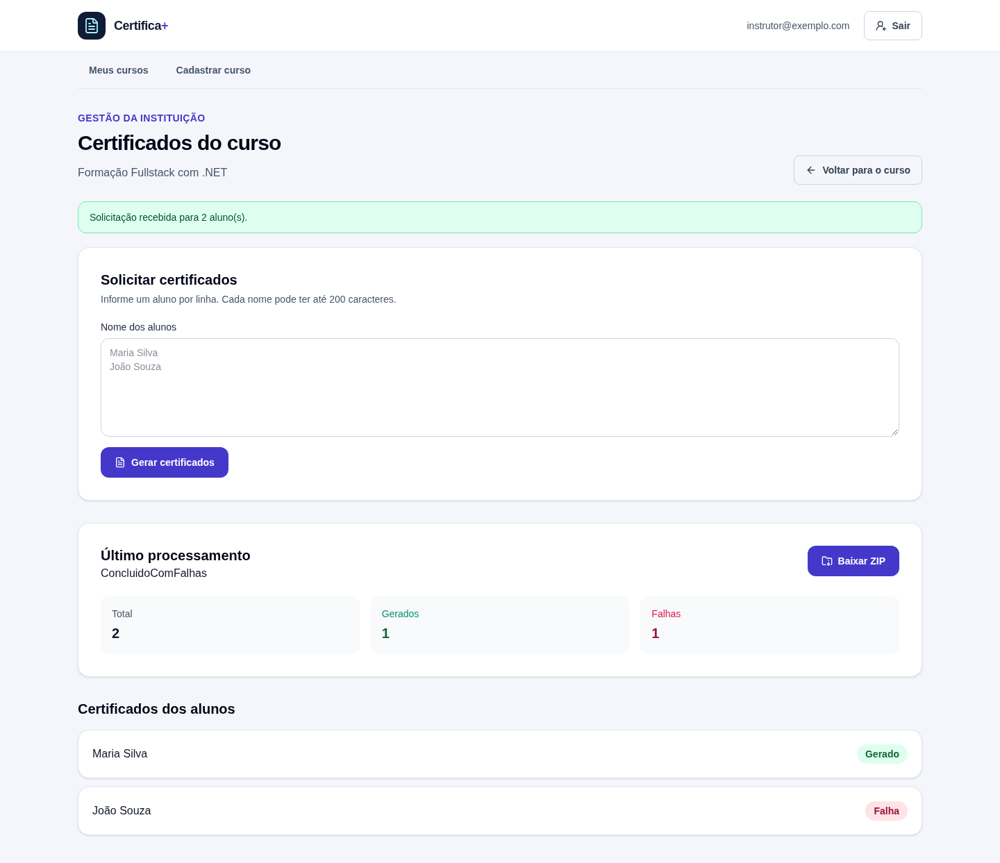

# Módulo de Certificados por Curso

## Emitindo certificados para uma turma

Um curso pode ter vários alunos.

Em vez de gerar cada certificado manualmente, a aplicação recebe os nomes da turma e solicita a geração de um lote.

Cada aluno recebe um certificado em PDF.

Os arquivos gerados são reunidos em um ZIP para download.

Nesta aula, vamos acompanhar o fluxo da tela Angular até o processamento assíncrono no backend.

## Acessando os certificados de um curso

Na tela de detalhes do curso, a pessoa seleciona **Gerenciar certificados**.

O client navega para uma rota que inclui o identificador do curso:

```text
/cursos/{cursoId}/certificados
```

O componente lê o `cursoId` e busca os dados do curso.

Depois, consulta o estado do último processamento e os certificados associados.

O `CertificadosService` centraliza as chamadas HTTP:

```typescript
solicitar(cursoId: string, req: SolicitarCertificadosRequest) {
  return this.http.post<SolicitacaoCertificadoDto>(
    `${this.urlApi}/cursos/${cursoId}/certificados`,
    req,
  );
}

obterStatus(cursoId: string) {
  return this.http.get<StatusProcessamentoDto>(
    `${this.urlApi}/cursos/${cursoId}/status`,
  );
}

listar(cursoId: string) {
  return this.http.get<readonly CertificadoDto[]>(
    `${this.urlApi}/cursos/${cursoId}/certificados`,
  );
}
```

O interceptor de autenticação envia o token Bearer da sessão.

Assim, a API consegue confirmar que a pessoa pode acessar aquele curso.

## Informando os nomes dos alunos

A tela apresenta um campo de texto com a orientação **um aluno por linha**.

Por exemplo:

```text
Maria Silva
João Souza
```

No envio, o componente separa o conteúdo por linhas, remove espaços no início e no fim de cada nome e ignora linhas vazias.

Em seguida, converte cada nome para o formato esperado pela API:

```json
{
  "alunos": [
    { "nome": "Maria Silva" },
    { "nome": "João Souza" }
  ]
}
```

O client exige ao menos um nome e informa se algum nome ultrapassa 200 caracteres.

A API também valida a requisição. A validação do servidor continua necessária porque outros clientes podem chamar o endpoint sem usar essa tela.

Enquanto a solicitação é enviada, o botão fica desabilitado e muda o texto para **Gerando certificados...**.

Quando a API aceita a solicitação, a tela limpa o campo e apresenta uma confirmação com a quantidade de alunos recebida.



## Por que a API responde antes de gerar os PDFs?

Gerar vários arquivos pode levar algum tempo.

Por isso, a API não mantém a requisição HTTP aberta até todo o lote terminar.

Ela valida os dados, cria um processamento e envia uma mensagem para a fila `gerar-certificados`.

Quando recebe a solicitação, a API responde com `202 Accepted`.

Esse código significa que o pedido foi aceito para processamento, não que todos os certificados já estão prontos.

O fluxo fica assim:

```text
Angular
  -> POST /cursos/{cursoId}/certificados
    -> API valida alunos e acesso ao curso
      -> cria um processamento
        -> publica mensagem na fila
          -> consumer gera os PDFs
            -> armazena os PDFs e monta o ZIP
```

O **consumer** é um componente que recebe mensagens da fila e executa o trabalho em segundo plano.

Neste projeto, a comunicação usa MassTransit e RabbitMQ.

## Gerando cada certificado

O consumer carrega o processamento e percorre os certificados pendentes.

Para cada aluno, o gerador de PDF recebe:

- nome do aluno;
- nome do curso;
- carga horária;
- data de conclusão.

O documento gerado apresenta esses dados em uma página A4 na horizontal.

O backend salva cada PDF e registra o resultado daquele aluno.

Se a geração de um certificado falhar, o processamento registra a falha e continua com os demais alunos.

Assim, uma falha individual não cancela o lote inteiro.

Depois de processar os itens, o backend reúne em um ZIP os certificados que foram gerados com sucesso.

## Entendendo o processamento e seus resultados

Cada pedido é representado por um processamento.

Ele acompanha informações como:

- situação geral do lote;
- quantidade total de certificados;
- quantos foram gerados;
- quantos falharam;
- se o ZIP está disponível.

Cada certificado também tem uma situação individual, como `Pendente`, `Gerado` ou `Falha`.

Se um lote ainda estiver em andamento, uma nova solicitação para o mesmo curso pode ser recusada com `409 Conflict`.

Isso evita iniciar dois lotes concorrentes para o mesmo curso.

O estado exibido na página é consultado quando ela carrega e novamente depois que uma solicitação é aceita.

> A atualização automática ou periódica do status fica fora do escopo desta aula.

O código HTTP `202` confirma o recebimento da solicitação; consulte o status depois para saber o resultado do processamento.

## Consultando o status e a lista de certificados

O status geral é obtido por:

```text
GET /cursos/{cursoId}/status
```

A resposta contém contadores do lote e informa se existe um ZIP disponível.

A lista individual é obtida por:

```text
GET /cursos/{cursoId}/certificados
```

Ela permite identificar para cada aluno se o certificado foi gerado ou se houve falha.

Se ainda não existir processamento, a API responde `404` para a consulta de status. A tela trata esse caso como ausência de um processamento anterior.

## Baixando os arquivos

Quando o processamento terminar e o ZIP estiver disponível, a API oferece:

```text
GET /cursos/{cursoId}/certificados/download
```

A resposta contém um arquivo `application/zip` com os PDFs gerados com sucesso.

Tentar baixar antes da conclusão pode resultar em `409 Conflict`.

> A API possui a rota de download. A tela apresenta o botão **Baixar ZIP**, mas a ligação do botão à chamada de download ainda não está implementada no client.

## Protegendo os dados

Todas essas operações recebem o identificador do curso e exigem autenticação.

A API obtém a identidade do token e verifica se o curso pertence ao usuário antes de iniciar o lote, consultar status, listar certificados ou baixar o ZIP.

Isso evita que conhecer o identificador de um curso seja suficiente para acessar os dados de outra instituição.

## Testando o fluxo

Com a API, o banco de dados e o RabbitMQ disponíveis:

1. Faça login e abra os detalhes de um curso da sua instituição.
2. Selecione **Gerenciar certificados**.
3. Informe um nome por linha e envie a solicitação.
4. Confirme a mensagem de recebimento e observe o status apresentado.
5. Consulte a lista para verificar o resultado individual de cada aluno.
6. Quando o ZIP estiver disponível, teste o endpoint de download pela API.

O arquivo `server/src/Api/GeradorCertificadosOnline.Api.http` contém exemplos de requisições e respostas para esses cenários.

## Conclusão

O módulo transforma uma lista de nomes em um processamento assíncrono associado a um curso.

A API valida o pedido e enfileira o trabalho; o consumer gera os PDFs individualmente e reúne os arquivos bem-sucedidos em um ZIP.

O client permite solicitar a geração e consultar os resultados exibidos, enquanto a atualização automática do status permanece para uma etapa futura.
