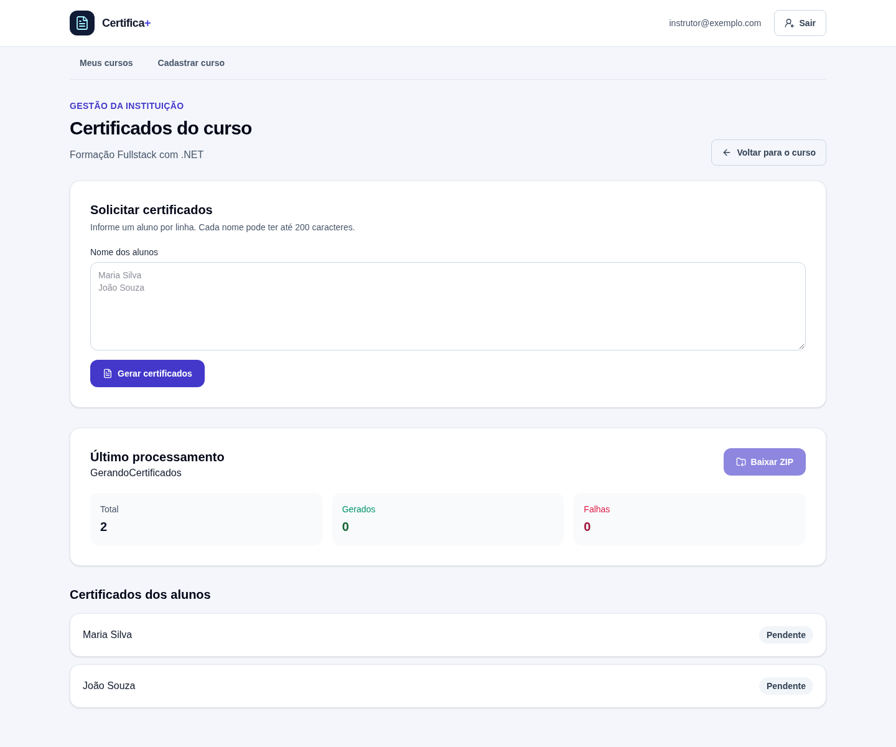
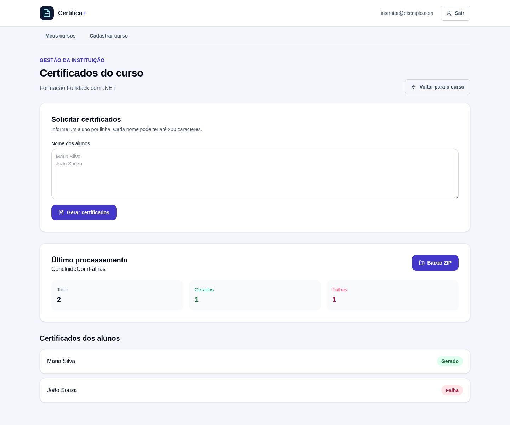

# Atualização de Status e Guardas de Rota

## Acompanhando um processamento em andamento

Na tela de certificados de um curso, a API pode informar que a geração ainda está pendente ou em andamento.

Se a tela consultasse o status apenas uma vez, a pessoa precisaria sair e voltar à página para descobrir se o processamento terminou.

Podemos automatizar novas consultas enquanto o processamento estiver ativo.

Neste material, também vamos proteger as rotas do Angular para evitar que pessoas sem sessão acessem as páginas de cursos.

## Atualizando o status com interval

O RxJS fornece `interval`, um Observable que emite números em períodos regulares.

Com `interval(5000)`, uma nova emissão ocorre a cada cinco segundos.

No componente de certificados, cada emissão inicia uma consulta ao endpoint de status:

```typescript
interval(5000)
  .pipe(
    exhaustMap(() => this.certificadosService.obterStatus(this.cursoId)),
    takeUntilDestroyed(this.destroyRef),
  )
  .subscribe({
    next: (status) => {
      this.status.set(status);
      this.carregarCertificados();
    },
  });
```

Quando chega uma resposta, o componente atualiza o Signal `status`.

Em seguida, busca novamente os certificados para atualizar o resultado individual de cada aluno.

`interval` espera o primeiro período antes de emitir.

Na abertura da tela, o componente faz uma consulta inicial do status. Se o processamento estiver `Pendente` ou `GerandoCertificados`, começa a consulta periódica.

## Evitando consultas simultâneas com exhaustMap

Uma requisição pode levar mais tempo do que o intervalo entre as emissões.

Se a próxima emissão chegar antes de a consulta anterior terminar, não queremos iniciar várias chamadas ao mesmo tempo.

`exhaustMap` ignora novas emissões enquanto a chamada anterior ainda estiver ativa.

Quando a requisição termina, a próxima emissão do intervalo pode iniciar outra consulta.

Isso evita acumular chamadas concorrentes ao endpoint de status.

## Encerrando a atualização quando necessário

Não há motivo para continuar consultando depois que o processamento termina.

Quando o status deixa de ser `Pendente` ou `GerandoCertificados`, o componente cancela a assinatura do intervalo:

```typescript
private pararAtualizacao(): void {
  this.consultaStatus?.unsubscribe();
  this.consultaStatus = undefined;
}
```

O componente também para a atualização se a consulta falhar.

O erro é apresentado na tela para que a pessoa saiba que o status não pôde ser atualizado.

## O que é DestroyRef?

O componente pode ser fechado enquanto ainda existe uma consulta periódica.

Por exemplo, a pessoa pode navegar de volta para os detalhes do curso.

`DestroyRef` representa o ciclo de vida do contexto Angular em que foi injetado.

Com `takeUntilDestroyed`, a inscrição no Observable termina automaticamente quando o componente é destruído:

```typescript
private readonly destroyRef = inject(DestroyRef);

// Na inscrição do intervalo:
takeUntilDestroyed(this.destroyRef)
```

Há dois encerramentos com objetivos diferentes:

- `unsubscribe()` interrompe a atualização quando o servidor informa um estado final ou ocorre um erro;
- `takeUntilDestroyed` garante a limpeza quando a tela deixa de existir.

> **Atenção:** uma inscrição esquecida pode continuar executando depois que a tela foi fechada. Vincule fluxos longos ao ciclo de vida do componente.

## Observando a atualização na interface

As imagens mostram a mesma tela em dois momentos: primeiro enquanto o processamento está pendente e depois que a consulta periódica recebe um resultado final.

As respostas da API foram simuladas no navegador para demonstrar a mudança sem depender de serviços externos.





## Protegendo rotas com guardas

O Angular Router permite executar uma verificação antes de ativar uma rota.

Essa verificação é chamada **guarda de rota** (*route guard*).

Na aplicação, as rotas de cursos exigem uma sessão autenticada.

As rotas de login e cadastro são destinadas a pessoas anônimas.

## Guarda para áreas autenticadas

A guarda `isAuthenticatedGuard` consulta o Signal de sessão do `AuthService`:

```typescript
export const isAuthenticatedGuard: CanActivateFn = (): true | UrlTree => {
  const authService = inject(AuthService);
  const router = inject(Router);

  if (authService.sessao()) return true;

  return router.createUrlTree(['/auth/login']);
};
```

Se existe uma sessão, a guarda retorna `true` e a navegação continua.

Caso contrário, retorna uma `UrlTree` para `/auth/login`.

Uma `UrlTree` descreve uma rota que o Router deve abrir. Retorná-la permite que o próprio Angular faça o redirecionamento durante a navegação.

## Guarda para telas de autenticação

Uma pessoa que já está autenticada não precisa voltar para cadastro ou login.

A guarda `isAnonymousGuard` permite essas rotas quando não há sessão e redireciona uma sessão existente para a página inicial:

```typescript
export const isAnonymousGuard: CanActivateFn = (): true | UrlTree => {
  const authService = inject(AuthService);
  const router = inject(Router);

  if (!authService.sessao()) return true;

  return router.createUrlTree(['/']);
};
```

As duas guardas usam `inject()` para acessar os serviços necessários.

Elas retornam uma decisão em vez de iniciar uma navegação manual dentro da função.

## Aplicando guardas a rotas aninhadas

As páginas de cursos compartilham uma rota pai chamada `/cursos`.

A configuração aplica a guarda ao pai e às rotas filhas:

```typescript
{
  path: 'cursos',
  canActivate: [isAuthenticatedGuard],
  canActivateChild: [isAuthenticatedGuard],
  loadComponent: () => import('./cursos/shell/cursos-shell').then((c) => c.CursosShell),
  children: [
    { path: 'listar', loadComponent: /* ... */ },
    { path: 'cadastrar', loadComponent: /* ... */ },
    { path: ':cursoId/certificados', loadComponent: /* ... */ },
  ],
}
```

`canActivate` protege a ativação da rota pai.

`canActivateChild` aplica a verificação às rotas filhas, incluindo listagem, cadastro, detalhes e certificados.

As rotas de autenticação usam a guarda anônima da mesma forma.

## O que uma guarda protege — e o que não protege

Uma guarda controla a navegação dentro do client Angular.

Ela melhora o fluxo de uso e evita exibir telas para a sessão errada.

Mas a guarda não substitui a autorização na API.

Uma pessoa pode chamar endpoints diretamente, sem usar a interface Angular.

Por isso, os endpoints continuam validando o token e a relação entre o usuário e o recurso solicitado.

> A guarda protege a navegação no navegador. A API continua responsável por proteger os dados.

## Testando o comportamento

1. Abra uma rota de cursos sem uma sessão e confirme o redirecionamento para `/auth/login`.
2. Faça login e tente abrir `/auth/login`; a guarda de pessoa anônima redireciona para a página inicial.
3. Abra a tela de certificados de um curso com processamento pendente.
4. Aguarde a consulta periódica e observe a atualização do status e dos resultados individuais.
5. Saia da tela durante o processamento; o componente é destruído e a inscrição vinculada ao `DestroyRef` é encerrada.

## Conclusão

`interval` permite consultar periodicamente o status de um processamento.

`exhaustMap` evita chamadas simultâneas, e `DestroyRef` com `takeUntilDestroyed` encerra a inscrição quando o componente deixa de existir.

As guardas do Router direcionam as pessoas de acordo com a sessão, enquanto a API permanece responsável pela autorização dos dados.
