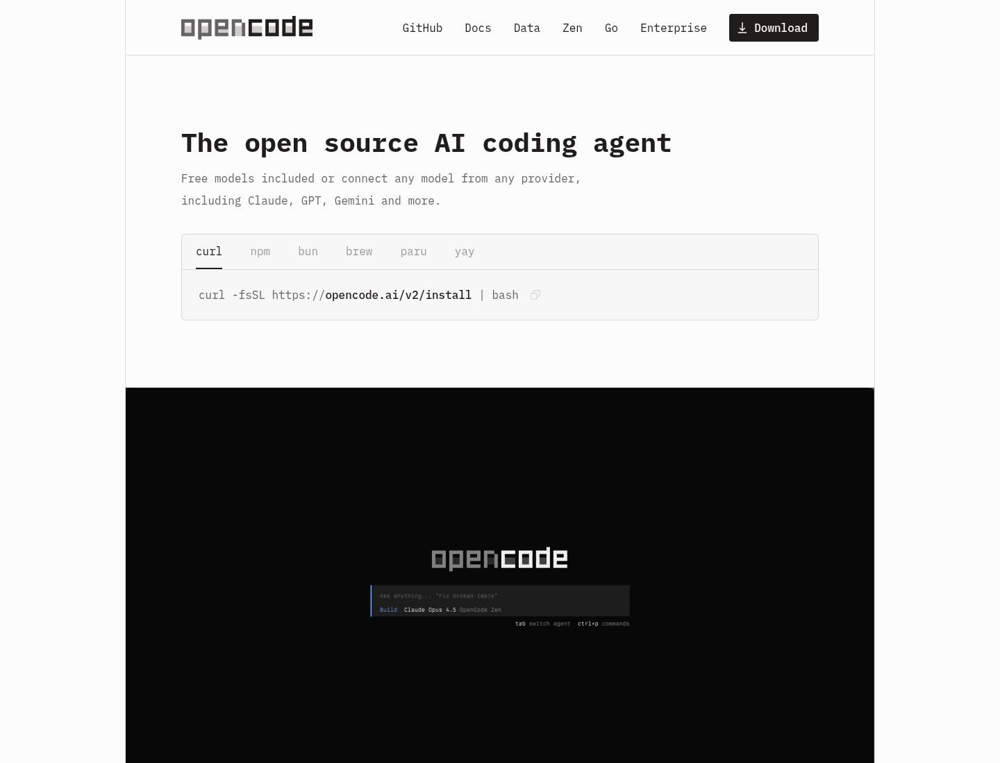

# Agentes de IA e OpenCode

## De uma conversa para uma tarefa de programação

Um chatbot pode explicar um trecho de código quando recebe esse trecho na conversa.

Mas, em um projeto real, também é útil pedir que uma ferramenta explore arquivos, sugira alterações e execute testes.

Para isso, existem os **agentes de programação**.

Nesta aula, vamos conhecer conceitos comuns dessa área e usar o OpenCode no Windows como um *harness* para trabalhar com um projeto.

## O que é um modelo de IA?

O **modelo** é o sistema de inteligência artificial que interpreta uma entrada e produz uma resposta.

Em uma ferramenta de programação, ele pode analisar instruções, código e resultados de comandos.

O modelo, por si só, não abre os arquivos do computador nem executa comandos. Ele precisa receber essas informações de um programa que faça essa conexão.

## O que é um agente de programação?

Um **agente** usa um modelo para trabalhar em uma tarefa em etapas.

Um ciclo comum é:

1. Receber uma solicitação e o contexto disponível.
2. Analisar o problema e decidir qual ação pode ajudar.
3. Usar uma ferramenta, como ler um arquivo ou executar um teste.
4. Analisar o resultado da ferramenta.
5. Continuar o trabalho ou apresentar uma resposta.

O agente pode repetir esse ciclo várias vezes.

Por isso, uma solicitação clara deve dizer qual é o objetivo e quais limites devem ser respeitados.

## O que é um harness?

Um **harness** é o ambiente que conecta o modelo ao trabalho que queremos realizar.

Ele organiza partes como:

- instruções e contexto enviados ao modelo;
- ferramentas disponíveis para consultar ou alterar o projeto;
- sessões de trabalho e histórico da conversa;
- permissões e pedidos de confirmação;
- conexão com um provedor e um modelo de IA.

O OpenCode é um agente de programação de código aberto que também funciona como esse ambiente de trabalho.

Ele pode ser usado no terminal, em um aplicativo para desktop ou por integrações com editores.

Na página inicial oficial, o OpenCode é apresentado como um agente de programação e mostra uma prévia da interface de terminal.



## Termos que aparecem nesse fluxo

### Provedor

O **provedor** é o serviço que disponibiliza o modelo e processa as solicitações.

Dependendo do provedor, a conexão pode usar uma conta, uma autorização pelo navegador ou uma chave de API.

Uma assinatura e uma chave de API não são necessariamente a mesma coisa. Verifique as condições e os possíveis custos do provedor escolhido.

### Prompt e contexto

O **prompt** é a instrução enviada ao agente.

O **contexto** é o conjunto de informações usadas para responder, como arquivos selecionados, instruções do projeto e resultados de ferramentas.

Um prompt pode ser específico sem ser complicado:

```text
Leia o fluxo de cadastro de usuários e explique como ele funciona.
Não altere arquivos. Aponte os arquivos que devo estudar primeiro.
```

### Ferramentas

As **ferramentas** permitem que o agente interaja com o ambiente.

Exemplos comuns são:

- ler e pesquisar arquivos;
- propor ou aplicar alterações;
- executar comandos e testes;
- consultar informações externas.

O conjunto de ferramentas depende do harness e das permissões configuradas.

### Permissões

As **permissões** determinam quais ações o agente pode realizar e quando precisa pedir confirmação.

Uma ferramenta que pode editar arquivos ou executar comandos oferece mais capacidade, mas também exige mais supervisão.

> O texto produzido pelo agente não é uma garantia de que o código está correto. Revise alterações e resultados antes de usá-los.

### Sessão

Uma **sessão** reúne a conversa e o trabalho relacionado a uma tarefa.

Separar tarefas em sessões ajuda a manter o contexto relevante e facilita retomar um trabalho depois.

### MCP

O **Model Context Protocol (MCP)** é um protocolo usado para conectar agentes a ferramentas e fontes de contexto adicionais.

Ele pode integrar serviços externos, mas não é necessário para começar a usar o OpenCode em um projeto local.

## Instalando o OpenCode no Windows

Neste tutorial, vamos instalar a interface de terminal do OpenCode.

Ela será usada dentro da pasta do projeto para que o agente possa consultar os arquivos daquele projeto.

### Preparando o Node.js e o npm

O **npm** é o gerenciador de pacotes do Node.js.

Ele também pode instalar ferramentas de linha de comando, como o OpenCode.

1. Acesse a página oficial do [Node.js](https://nodejs.org/en/download/).
2. Baixe o instalador **LTS** para Windows.
3. Execute o instalador e mantenha as opções padrão, incluindo o npm.
4. Ao terminar, abra uma nova janela do PowerShell.

Confira se Node.js e npm estão disponíveis:

```powershell
node --version
npm --version
```

### Instalando o OpenCode com npm

No PowerShell, instale o CLI do OpenCode globalmente:

```powershell
npm install -g @opencode/cli
```

O npm executa uma etapa de instalação que seleciona o binário nativo adequado para o sistema operacional.

Confirme que o comando está disponível:

```powershell
opencode --version
```

Se o PowerShell não reconhecer `opencode` logo após a instalação, feche e abra uma nova janela do terminal e tente novamente.

> **Atenção:** instale o pacote oficial `@opencode/cli`. Não coloque chaves de API como argumentos do comando de instalação.

## Conectando um provedor e selecionando um modelo

O OpenCode é a ferramenta que organiza o trabalho.

Para gerar respostas, também precisamos conectar um provedor e selecionar um modelo disponível nessa conexão.

As credenciais devem ser configuradas pela tela de conexão do OpenCode, não enviadas como texto em uma conversa.

## Abrindo o projeto

Abra o PowerShell e navegue até a pasta de um projeto:

```powershell
cd C:\caminho\para\o\projeto
```

Confira que está na pasta correta:

```powershell
pwd
```

Inicie o OpenCode:

```powershell
opencode
```

O OpenCode abre uma interface interativa no terminal, chamada **TUI** (*text user interface*).

Digite `/connect` para conectar um provedor e siga as opções apresentadas.

Depois, use `/models` para selecionar um modelo disponível nessa conexão.

> A disponibilidade de provedores, métodos de autenticação, modelos e preços depende do serviço escolhido.

## Fazendo uma primeira solicitação

Comece pedindo uma explicação sem solicitar mudanças no código:

```text
Explique a estrutura deste projeto e indique por onde começar a estudá-lo.
Não altere nenhum arquivo nem execute comandos.
```

Depois, experimente incluir um arquivo específico usando `@`:

```text
Explique o fluxo de validação em @src/Program.cs.
Não altere o arquivo.
```

O `@` ajuda a localizar um arquivo e incluí-lo explicitamente no contexto.

Quando estiver confortável, peça uma mudança pequena e verificável:

```text
Adicione uma validação para impedir nomes vazios no formulário de cadastro.
Antes de editar, explique quais arquivos pretende alterar.
Depois, execute os testes relacionados e resuma o resultado.
```

Leia com atenção qualquer pedido de permissão que aparecer.

Autorize apenas ações que façam sentido para a tarefa atual.

## Entendendo os agentes do OpenCode

O OpenCode oferece perfis de agente para diferentes tipos de trabalho.

Um perfil pode definir instruções, modelo preferido e permissões.

Na interface, use `/agents` para consultar ou selecionar os agentes disponíveis.

Os agentes padrão **Plan** e **Build** são dois perfis principais, cada um adequado a uma etapa diferente do trabalho.

### Plan: entender e planejar antes de editar

Use **Plan** quando ainda estiver investigando o problema ou decidindo como resolvê-lo.

Esse agente pode explorar o projeto, ler arquivos e preparar uma proposta de trabalho, mas não altera os arquivos normais do projeto.

Por exemplo, peça:

```text
Analise como o cadastro de cursos está organizado.
Não altere arquivos. Sugira um plano para adicionar uma validação de nome.
```

O Plan ajuda a entender quais partes podem ser afetadas antes de começar a implementação.

Ele não é um modo sem ferramentas: comandos de terminal continuam sujeitos às permissões configuradas.

Se solicitado, o Plan também pode salvar um documento de planejamento próprio do OpenCode.

### Build: implementar e verificar

Use **Build** quando já souber o que deseja fazer e estiver pronto para trabalhar nos arquivos do projeto.

Esse é o agente padrão para tarefas de programação. Ele pode ler e editar arquivos e executar comandos, de acordo com as permissões ativas.

Por exemplo, depois de revisar o plano, selecione **Build** com `/agents` e peça:

```text
Implemente a validação definida no plano.
Execute os testes relacionados e explique os arquivos alterados.
```

No perfil padrão, a leitura de arquivos de ambiente sensíveis, como `.env`, pede confirmação. Outras permissões podem depender da configuração local ou do projeto.

> Mesmo quando o agente executa os testes, revise as alterações e confirme o resultado por conta própria.

Um fluxo inicial simples é:

1. Selecione **Plan** e peça uma análise sem alterações.
2. Leia e ajuste a proposta até ela corresponder ao objetivo.
3. Selecione **Build** e peça a implementação em passos pequenos.
4. Revise o diff e execute as validações do projeto.

Um **subagent** é um agente auxiliar usado para uma tarefa mais delimitada, como explorar arquivos ou revisar uma mudança.

O subagent não é uma pessoa nem uma validação independente garantida. Confira as conclusões e os arquivos do mesmo modo.

## Revisando o trabalho do agente

Depois que o agente propuser alterações:

1. Leia a explicação e confira quais arquivos foram modificados.
2. Examine o diff no editor ou com `git diff`.
3. Execute os testes e comandos de validação do projeto.
4. Corrija ou rejeite mudanças que não correspondam à tarefa.
5. Só então decida se deseja registrar as alterações no Git.

> **Atenção:** o agente pode ler o código incluído no contexto e enviar informações ao provedor conectado. Não inclua senhas, tokens, chaves privadas ou dados pessoais no prompt. Respeite também as regras de segurança e privacidade do projeto.

## Encerrando o uso

Para sair da interface do terminal, pressione `Ctrl+C`.

As sessões podem ser retomadas pelo próprio OpenCode.

Antes de fechar o trabalho, confira se o agente deixou arquivos modificados que você ainda precisa revisar.

## Conclusão

Um modelo gera respostas, e um agente usa o modelo em um ciclo de análise e ações.

O harness conecta esse ciclo ao projeto e organiza contexto, ferramentas, sessões e permissões.

Com o OpenCode, podemos começar pedindo explicações, avançar para alterações pequenas e manter a revisão humana durante todo o processo.

## Referências

- [Documentação do OpenCode V2](https://opencode.ai/v2/docs/)
- [Downloads oficiais](https://opencode.ai/download)
- [TUI do OpenCode](https://opencode.ai/v2/docs/cli/tui/)
- [Provedores e autenticação](https://opencode.ai/v2/docs/cli/providers/)
- [Agentes](https://opencode.ai/v2/docs/agents/)
- [Permissões](https://opencode.ai/v2/docs/permissions/)
